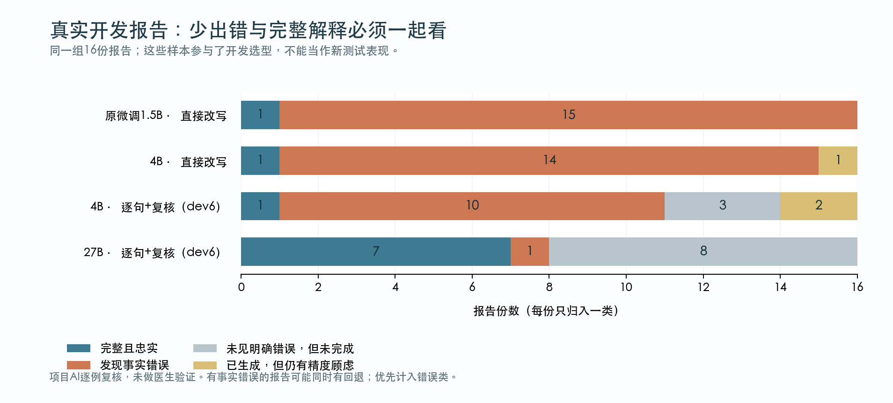

# 第二版方法说明（开发中）

最终模型与测试数字尚未确定。使用方法在候选冻结后再确认；第一版的启动器与训练结果继续保留。

## 这个项目实际做什么

输入是英文或中文的放射科报告文本，输出是对应原文的中文解释。它不看CT图像，不给出独立诊断，也不根据报告自行制定治疗。原报告已经提出的复查建议可以忠实转述。

第一版解决了“能不能训练一个在Mac上运行的中文改写模型”。第二版重点解决“说得流畅时，是否也说对了”，同时保留第一版作为实际基线。

## 为什么不能只换一个大模型

开发测试发现，直接让大模型写得通俗，会诱发原文没有的补充。例如，原文只说管尖位于某处，模型却增加“位置正常”；原文只写轻度肺不张，模型却增加原因和“不严重”的安慰。这些话听起来合理，仍然不是原报告的内容。

因此，比较的是完整方法，而不是参数量大小。4B、9B和更大候选都要实际运行。更大的模型需要学校GPU，本机版本仍要适应8GB内存。

## 一次解释怎样产生

先按句子切分报告，并记录每段在原文中的位置。每句话生成一段中文，前文只帮助理解指代，不能把后文的新结论提前带入。专业名词可以保留，另用固定词典解释，减少模型临时编造医学知识。

然后执行两种不同的核对。规则比较部分数值、日期、左右、解剖部位、否定和建议措辞；模型复核比较原句和改写的含义。规则擅长明确模式，但不能知道所有词义；模型复核能处理较复杂的关系，却也可能和生成模型犯同样的错。两者都不是临床证明。

发现问题时，最多重新改写一次。仍有问题就保留原句，并说明这一句的中文解释没有完成。失败候选只存在研究记录里，不出现在给用户看的网页正文中。

## 三个不能混在一起的数字

| 统计 | 含义 | 不能说明什么 |
|---|---|---|
| 完整生成报告数 | 程序为全部符合条件的片段生成了中文 | 不代表中文内容正确 |
| 有观察到的事实错误的报告数 | 项目AI逐例发现至少一处事实问题 | 不是医生裁定的错误率，也不是患者总体表现 |
| 完整且忠实的中文报告数 | 没有回退，关键事实完整，复核中未见明显改变或疑点 | 不构成临床验证 |

“我不知道，所以只显示英文原句”可以避免展示某个错误，但并没有满足中文解释需求。评估必须把这种未完成情况单独算出来。

## 为什么新测试要留到最后

原有20条合成样例和新16份公开真实报告用于开发：可以看错误、修改提示词、增加术语、选择模型。另一组48条合成报告与24份真实报告已经预先固定。每个方案先冻结再运行；为利用已分配的GPU，GPU方案可先单独运行，但必须等全部本机候选也冻结后，才能查看任何最终预测。这个资源安排在生成前已经记录于[冻结流程补充](冻结流程补充.md)。

候选冻结会记录模型来源、模型文件散列、代码散列、生成长度和方法。之后用同一套新测试比较原来的小模型、更强模型直接改写、逐句改写与核对。看完新测试后发现的问题，写入结果和局限；不能改完代码后仍把同一批题叫作“没有看过的新测试”。

真实报告来自公开数据集，但患者级别独立性和模型预训练数据重叠无法确认。这里的中文参考与逐例分析由AI完成，没有医生和真实患者理解测试。

## 训练、量化和推理的区别

第一版确实进行了LoRA微调：让较小模型学习英文报告到中文解释的示例，只训练一小部分附加参数。第二版优先测试更好的现成模型与解释流程；如果这一轮没有继续训练，就明确记为推理方法改进。

量化是用较低精度保存或计算权重，以降低内存需求。Mac使用公开的MLX 4bit转换；学校GPU上的候选可用BF16或NF4。它们的精度、硬件和运行库不同，所以速度不能只归因于模型参数数量，也不能把公开转换模型称为自己训练的成果。

## 网页与数据

中文解释页面是本地独立HTML，能展开对应原文，词义解释附来源。浏览器显示页面不需要把报告发到外部服务。原文、失败候选和结果可能包含医学信息，真实报告与个人输入目录不提交GitHub。

## 方法参考

- [RadiologyInfo的AI报告解释说明](https://www.radiologyinfo.org/-/media/files/radinfo/pfcc-ai-patient-handout.pdf?rev=bd4977bccddd4cdca2d439f46a6fa68d)：AI解释辅助理解，原报告仍是正式记录。
- [NCI医学术语词典](https://www.cancer.gov/publications/dictionaries/cancer-terms)：部分固定词义来源；每条具体解释另外给出直达链接。
- [Fleischner Society胸部影像术语表，2024](https://doi.org/10.1148/radiol.232558)：肺叶、影像外观和位置词的参考。
- [Qwen3.5-4B](https://huggingface.co/Qwen/Qwen3.5-4B)、[9B](https://huggingface.co/Qwen/Qwen3.5-9B)、[27B](https://huggingface.co/Qwen/Qwen3.5-27B)：模型发布方资料；通用基准不代替本项目实测。
- [Transformers的bitsandbytes量化文档](https://huggingface.co/docs/transformers/quantization/bitsandbytes)：GPU低精度推理实现。

## 怎样读开发对比图

蓝色才表示这次AI复核认为全文关键事实保留。灰色表示没有看到明确错误，但有句子未完成中文解释；黄色表示全文有输出，仍有精度顾虑。橙色优先记录已发现的事实错误，所以一份既有错误、又有回退的报告不会藏进灰色里。图中是已经完成的dev6流程对比；更新的本机实验仍在运行。开发报告参与过选型，因此不能把这张图当作最终新测试成绩。

可用独立绘图环境安装`requirements-v2-report.txt`，再运行`python -m scripts.plot_v2_outcomes --manifest examples/v2/development_chart_manifest.json --out <新文件前缀>`。绘图先核对每例输出散列与复核记录，不使用规则通过率推断正确性。真实原始文本不随仓库分发，重绘该图需要本地保存的开发结果。

## 可复现的配对统计和中文文档

`scripts.compare_v2_reviews`比较同一份报告在两个方案中的状态，同时保留新出现的错误和丢失的完整解释；输入集合不同或复核散列过期时拒绝计算。它不会把回退当作正确答案。

`scripts/build_v2_report.py`将已复核的Markdown和本地图片排成中文PDF。开发预览每页明确标注“不是最终测试报告”；最终模式只在全部候选冻结、查看限制解除后使用。当前排版使用macOS自带STHeiti字体，绘图和PDF依赖放在独立报告环境，避免影响模型实验。最终交付前仍须将PDF逐页渲染并检查，不能仅凭文件生成成功判断排版正确。
