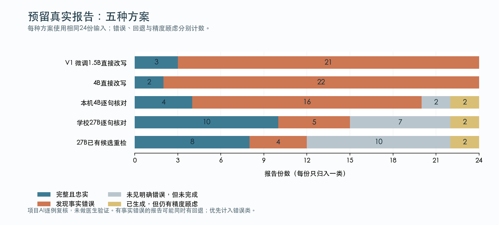

# 第二版最终结果：更强模型有帮助，但仍会改错

本轮研究交付已补齐。学校连接恢复后，取回了原先完成的27B结果，核对文件校验值，完成逐例复核及预先冻结的规则重检，没有重新训练或重复提交GPU作业。本报告接续并补齐此前的本机报告与14:00窗口结束记录；自动任务保持暂停。

**主要结论：合成短报告明显改善，真实长报告仍未达到可靠患者解释水平。** 48条预留短报告，完整忠实解释由V1的23条提高至本机V2的43条，学校27B为45条。24份预留真实报告，对应为3、4、10份；即使27B仍有5份发现明确错误、7份未见明确错误但没有完成、2份有精度顾虑。这些是项目AI复核，不能称为医学准确率。

## 到底做了哪些东西

V1保留原本在A100上完成的1.5B模型LoRA微调、权重和结果。V2主要改进推理流程：先分句，每句对应原文，生成中文；用有限规则和同一模型核对，再允许一次修订；仍不通过时显示原文回退；另外附上有来源的术语释义。没有从头训练基础模型，也没有把27B说成我们新训练的模型。

本机使用Qwen3.5-4B的4bit版本，适合这台8GB Mac进行研究试用；学校使用Qwen3.5-27B的NF4量化版本作为更强参考。27B的代码快照、词典和量化与本机方案不同，所以这里比较的是整套方案，不能把全部收益都归因于模型参数更多。

另一个冻结方案只重新筛选27B已经生成的候选，沿用原来的模型判定和词典，不调用模型、不重写答案。它在开发数据有改善，最终测试却出现了代价；失败也完整保留。

## 相同输入上的五方案结果

“完整忠实”要求关键事实保留且中文解释完成。“全文生成”只表示没有片段回退，不能证明事实正确。“发现错误”按报告计数，一份中有一处错误就计入；有错误的报告也可能同时有回退。三列不能相加。

### 48条预留合成短报告

| 方案 | 完整忠实 | 发现错误 | 全文生成 | 中位耗时 |
| --- | --- | --- | --- | --- |
| V1微调1.5B直接改写 | 23/48 | 17/48 | 48/48 | 0.68秒 |
| 同一4B直接改写 | 26/48 | 16/48 | 48/48 | 2.23秒 |
| 本机4B逐句核对 | 43/48 | 2/48 | 47/48 | 7.94秒 |
| 学校27B逐句核对 | 45/48 | 2/48 | 47/48 | 8.07秒 |
| 27B已有候选重检 | 45/48 | 2/48 | 47/48 | 8.07秒 |

前3种在Mac运行，后2种包含A100原始推理时间；硬件不同，耗时不能用来证明谁的算法更快。耗时不包括模型加载。合成数据包含24条英文与24条中文，不能代替真实中文临床报告测试。

### 24份预留真实报告

| 方案 | 完整忠实 | 发现错误 | 全文生成 | 中位耗时 |
| --- | --- | --- | --- | --- |
| V1微调1.5B直接改写 | 3/24 | 21/24 | 24/24 | 1.83秒 |
| 同一4B直接改写 | 2/24 | 22/24 | 24/24 | 10.11秒 |
| 本机4B逐句核对 | 4/24 | 16/24 | 12/24 | 63.61秒 |
| 学校27B逐句核对 | 10/24 | 5/24 | 14/24 | 51.48秒 |
| 27B已有候选重检 | 8/24 | 4/24 | 12/24 | 51.48秒 |

27B相较本机V2保留了原来4份完整忠实报告，新增6份。两者共同有错4份；本机另外12份的明确错误不再观察到，27B另有1份新增错误。错误消失的12份不等于都被正确补齐，因为有些仍不完整或有精度顾虑。全文生成方面有2份丢失、4份新增，净增2份。

片段完成度分别为：本机203/234，27B为206/234，27B重检为204/234。分母沿用冻结计划，报告中被拆出的标题、序号等也保留，不在看见结果后删除难例来抬高分数。

## 为什么更严的检查反而损失了答案

27B重检在真实报告上恢复了3个片段，同时撤回5个片段。它隐藏了一个模型新增的紧急检查建议，使有错报告从5降至4；但还撤回原本忠实的骨折后遗描述、鼻胃管在食管下三分之一的位置，以及一条感染程度结论。

结果是完整忠实报告从10降至8，全文生成从14降至12，没有新增完整忠实报告。原有错误中的4份仍在。因此不能用“错误更少”宣称整体能力提高，也不能把未输出误当成答对。这个开发阶段看似有用的方法，在最终数据上的限制已经暴露，没有据此继续调整同一测试的规则。

本轮原始模型输出共288条；额外72条是已有候选重检，没有新模型调用。所有原始输出逐例复核。重检的64例在原文、中文、显示状态和词义机械核对一致后沿用原判断，其余8例另行复核；每份判断都绑定具体输出的散列。

## 用例子理解剩余问题

合成短例中，27B能保留“没有局灶性实变”的限定，本机版曾扩大成“没有实变”。但27B也会把“右上肺3毫米结节”写成“右上肺叶有一个3毫米结节”：肺区被擅自细化为特定肺叶。数字没错不代表句子忠实，两类错误恰好说明只检查数字不够。

真实报告中仍发现：无依据解释含混的病历栏目；遗漏双下叶后部定位；把已做检查的标题改成建议再做检查；把“没有显著淋巴结肿大”扩大成“没有肿大”；把颈静脉擅自指定为颈内静脉。这5份错误都保留在逐例记录中。

另有两份没有计成明确错误，但没有算完整忠实：一份把包膜下及高血供摄取表达得生硬含混；一份对迁延病程的表达不够清楚。词义含混不应强行包装成精确答案，也不应为了漂亮的数字硬判全对。[肝包膜解剖资料](https://pmc.ncbi.nlm.nih.gov/articles/PMC6448667/)仅用于核对术语，不代表对本工具的临床认可。

中文可读性仍是短板：27B真实报告的AI风格判断为2份通俗、13份混合、9份专业。准确直译、附词典和真正让患者看懂并不等价；这些风格标签也不是患者理解测试。

## 本机怎么用，学校模型要多少资源

双击本机交付中的`启动中文报告解释.command`，或项目内`开始解释报告_V2.command`，输入英文或中文报告即可得到逐句中文与本地HTML。默认继续使用开发阶段固定的4B方案，并没有偷偷替换为学校27B。原V1启动器也保留。

本机4B最终真实报告总推理2174.5秒，约36.2分钟；MLX峰值分配3.23GiB，加载约2.28秒另计。内存数字不包含全部系统占用，8GB Mac同时运行其他应用时体验会变化。

学校27B完成48条短报告用451.8秒，24份真实报告用1691.9秒，约28.2分钟；加载33.49秒，CUDA峰值分配17.18GiB，运行设备为A100 40GB。这个实测配置无法直接装进8GB Mac。重检仅额外消耗约0.023秒和0.069秒CPU时间，但完整保留原来的模型计算成本。

此前还测试了其他本机模型、去掉前文的消融、思考复核与NLLB翻译探针。它们的失败和代价在本机报告中保留，没有将未完成运行计成成功，也没有将后来试验的开发数据伪装成新的独立最终测试。

## 这次完成了什么，下一步应做什么

已完成可运行的中文解释入口、真实基线与V1微调、V2生成与核对流程、五方案最终对比、中文示例、错误分析、复现记录和GitHub提交。学校访问阻塞已经解除，待取回的评估结果已补齐；此阶段研究交付完成，不等于模型达到医疗部署标准。自动任务保持暂停，不再自动启动训练。

122项此前Mac可运行测试通过，实际CLI入口已生成HTML；两份旧Torch依赖的V1测试模块未在MLX环境执行。本次恢复后只取回预测、执行已冻结重检和补充评估文档，未更改冻结的模型推理代码；复核散列与数据一致性另行核验。

全部质量复核由项目AI完成，不独立、不盲，也没有医生裁定。真实报告仅24份，按文本去重不能证明患者级独立，无法排除预训练重叠；错误没有按临床严重程度加权。后续应优先做长文结构与限定范围处理，取得专家标注并在另一组未见真实报告上验证，再单独测试患者能否理解。不能继续拿本组最终测试调参后宣称泛化提高。

代码和审计材料位于私人仓库[radiology-plain-zh](https://github.com/lucaaaas-glich/radiology-plain-zh)，本轮变更见[PR #2](https://github.com/lucaaaas-glich/radiology-plain-zh/pull/2)。真实报告原文与完整真实输出留在忽略目录；模型权重不上传GitHub。之前的本机结果、窗口结束记录、V1和另一个YOLO作业均保留。
