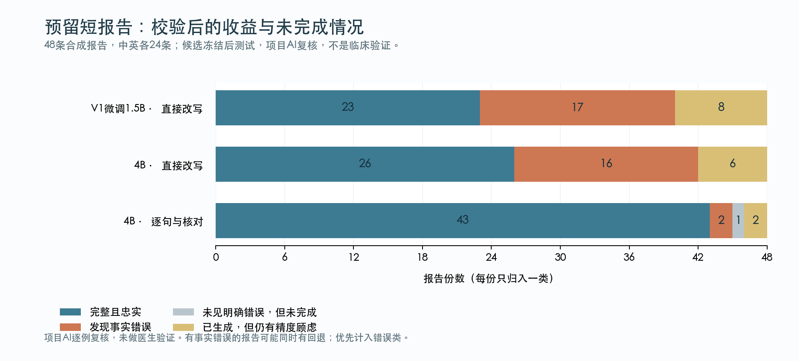
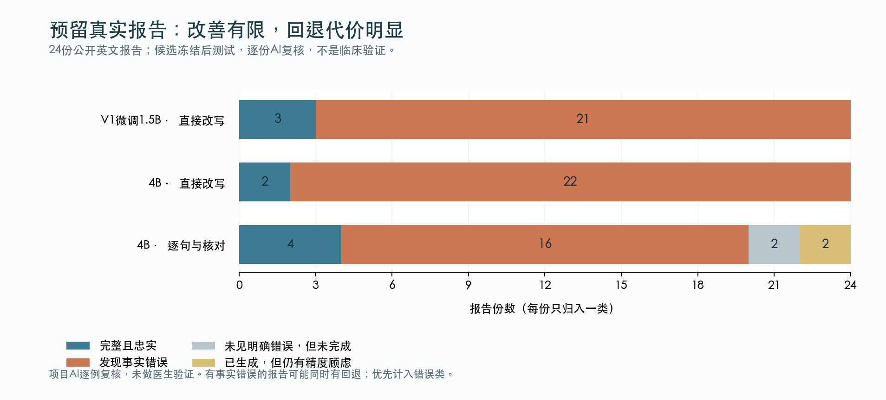

# 中文影像报告解释：第二版本机实测与讲解

本机工具已经能运行，短报告也确实改善了；但真实长报告效果仍不理想。24份真实测试只有4份达到本次AI复核的完整且忠实，16份仍有错误。它适合研究与学习，尚不能独立承担患者报告解释。下面把改善、拒绝改写与残余错误分开说明，不把这些数量称为医学准确率。

本文是本机三方案的最终测试报告。学校27B的推理已完成，但连接中断后的结果取回与最终复核尚未完成；这部分不填入最终成绩，也不据开发结果断言27B赢得最终对比。

## 先开始使用

在Finder打开 /Users/jiangfu/Downloads/3710/radiology-plain-zh，双击“开始解释报告_V2.command”。粘贴报告后按一次空行，程序加载本地模型、显示逐句进度，完成后打开中文网页。输入q退出。每段可展开对应原文，专业词另有带来源的释义。

输出保存在项目的data/v2/explanations，不提交GitHub。模型已下载，日常使用不依赖学校GPU；本地推理脚本不把报告发送到外部服务。第一版启动器和原权重保留。V2与另一个YOLO项目分目录、分环境。

## 新测试：短报告

测试预留48条合成短报告，中英文各24条。测试内容、统计口径、候选代码、模型文件和参数在观察最终输出前固定。下表是项目AI逐例复核，不是独立医生判断。

| 方案 | 发现事实错误 | 完整且忠实 | 全文生成 |
|---|---|---|---|
| V1微调1.5B直接改写 | 17/48 | 23/48 | 48/48 |
| 4B直接改写 | 16/48 | 26/48 | 48/48 |
| 4B逐句生成与核对 | 2/48 | 43/48 | 47/48 |

“有错”是至少发现一处明确事实问题，不表示整篇每句话都错。“完整且忠实”要求中文全文完成、关键事实保留，且本次复核没有明显问题或精度疑点。它比“没有发现错误”更严格。三列不能相加。

按冻结数据中的输入语言分组，24条英文转中文的完整忠实数为8→13→20；24条中文改写为15→13→23。两组都观察到收益，但中文原文直接保留很多词更容易保真，不能等同于已经把专业中文说得更通俗。这是最终复核后的描述性分组，没有新增独立验证。

逐句方案另外有1份保留原文而未完成、2份虽然全部生成但仍有精度顾虑。69个应解释片段完成68个，另外2段注入指令被排除。发生7次重写尝试，其中6次最终提供了中文；这里的接受数不等于正确修复数。

与V1逐份配对，17份原有错报告不再观察到明确错误，但新增2份有错报告。21份原来忠实的解释保留，22份新增，2份丢失。不能把17份旧错误消失都说成“全部修好”，其中还包含回退和表述疑点。

与同一个4B直接改写相比，逐句方案有14份原有错报告不再观察到错误，2份仍有错，没有新增有错报告；完整忠实解释新增19份、丢失2份。可见收益主要来自本次完整流程，而非只把模型换大。

忠实不等于足够通俗。AI可读性判断中，逐句方案48份里12份较通俗、32份混合专业词、3份偏专业、1份没有中文正文；V1直接改写有38份较通俗，4B直接改写有40份较通俗。新方法为保留事实减少自由发挥，部分中文输入几乎照抄原句，靠附加词典帮助理解。因此这轮不能声称患者可读性已经全面提高。

## 新测试：真实报告

这24份是预先抽取的公开英文报告，长度和内容更接近实际文书，包含复杂长句、病史、术语和去标识占位。短报告的好结果没有等比例推广过来。

| 方案 | 发现事实错误 | 完整且忠实 | 全文生成 |
|---|---|---|---|
| V1微调1.5B直接改写 | 21/24 | 3/24 | 24/24 |
| 4B直接改写 | 22/24 | 2/24 | 24/24 |
| 4B逐句生成与核对 | 16/24 | 4/24 | 12/24 |

逐句方案有2份未见明确错误但未完成，另有2份全部生成但存在精度顾虑。234个应解释片段生成203个，31个保留原文；片段覆盖率86.8%，不代表其中86.8%正确。39次修订尝试只有8次最终提供中文，仍不能把接受看作正确修复。

和V1配对，16份原有错报告仍有错，5份不再观察到明确错误，没有新增有错报告。但原有3份完整忠实只增加了1份，全文完成从24降到12。与4B直接改写相比，完整忠实增加2份。这里的主要代价是拒绝解释，不能把错误报告数减少5份说成“修好了5份”。

部分未完成句子恰好是重要结论或病史，而不只是无关文字。余下错误包括：把替代诊断心衰改成没有心衰证据；把检查当天改成该日期以前；把约6毫米病灶的尺寸写成所在位置；把腹膜内误成腹膜后。表中每一项都能追溯到实际输出和逐例记录。

可读性判断为1份较通俗、15份混合专业词、8份偏专业。没有真实患者参与。这个本机版本适合继续研究与学习，尚不能独立满足复杂报告的可靠中文解释需求。

## 实际生成的三个例子

以下例子均来自合成测试的实际机器输出，不是真实患者记录，也没有手动润色后冒充生成结果。同目录提供三个可打开的HTML。

例一，保留数字和参照位置：原文说气管导管尖端在隆突上方2.5厘米，且没有气胸。实际中文是“气管导管尖端位于隆突上方 2.5 厘米。”“没有气胸。”旁边把隆突解释为气管分成左右主支气管的地方。这次没有额外断言“导管位置正常”。见“V2_示例_导管位置.html”。

例二，拒绝不等于答对：原文日期为03/07/2025，日月顺序不明确，模型最终保留英文原句，并明确表示没有完成中文解释。这减少了展示错误日期的机会，但没有满足用户阅读中文的需求，统计中算未完成。见“V2_示例_日期不确定.html”。

例三，校验仍然漏错：原文“No pleural effusion or focal consolidation.”生成“没有胸腔积液，没有实变。”其中focal（局灶性）被遗漏，阴性范围被扩大。规则和模型复核没有拦住。另一条有冲突的报告保留了有积液/无积液的矛盾，却漏掉了“小量”。见“V2_示例_仍会遗漏限定词.html”。

## 速度、内存与取舍

以下为这台共享8GB Mac的实际生成耗时，模型加载另计。数字不是在空闲专用机器上测的，其他应用和交换空间会影响速度。

| 方案 | 短报告中位数 | 真实报告中位数 | MLX峰值分配 |
|---|---|---|---|
| V1直接改写 | 0.68秒 | 1.83秒 | 1.37GiB |
| 4B直接改写 | 2.23秒 | 10.11秒 | 3.01GiB |
| 4B逐句与核对 | 7.94秒 | 63.61秒 | 3.23GiB |

峰值取该方案两组运行中的较大值；它不是整个进程或系统的总内存。逐句方案48条短报告共504.3秒，24份真实报告共2174.5秒，最长单份313.8秒。每轮模型加载约2.3—2.7秒。权重文件约3GB的4bit模型已保存在本机，MLX的5.5GiB内存参考线不是操作系统硬上限。

学校A100 40GB的27B NF4参考已完成推理：48条短报告451.8秒、24份真实报告1691.9秒，加载33.5秒，峰值GPU分配约17.18GiB。原始权重下载约55.6GB。这些来自运行元数据，说明任务跑完了；因为结果尚未取回复核，不能据此填造质量成绩。Mac和A100的硬件、代码与量化不同，不能用耗时直接证明模型优劣。

## 第一版和第二版分别做了什么

你最初感兴趣的是“把医嘱改成病人能读懂的话”。这一轮具体实现并测试的是放射科报告文字解释，例如胸片和CT的文字发现。它不读取CT图像，不开药，也没有验证用药医嘱、手术方案或出院用药说明。

第一版确实训练了模型：用7B教师生成中文示例，再让1.5B学生通过LoRA学习。可以把它理解为只训练一小组附加参数，学习任务的表达方式。实际用了4,066条合成训练例子，A100训练约9.4分钟，生成标签与评估另计。

V1的ROUGE-L从0.409升到0.553，chrF从26.89升到37.33。这说明学生更像合成教师参考的写法，不能证明医学事实更准确。教师和学生也可能共享错误。

第二版没有继续训练新权重。它使用现成的Qwen3.5-4B量化模型，加上逐句原文对应、部分数字与否定规则、同模型语义复核、最多一次重写和38条有来源的固定词义。量化减少内存需求，和让模型学习新知识是两回事。

生成器像先写译文的人，复核器像检查员。但两者是同一个模型，可能共享盲点。原意是“可能存在某处浸润”，输出却变成“有阴影，可能是感染”；两句都有“可能”，不确定性却从有没有发现转移到了病因。只找关键词不能保证含义相同。

另一个长报告失败来自文档结构：罗马序号被拆成单独片段，引发无意义的生成和回退，增加耗时。发现最终测试问题后，本轮保留原候选和失败，没有修好再把同一批题当新测试。

## 为什么没有继续堆模型或训练

开发阶段另外测试了Qwen3-4B、Mac上的Qwen2.5-7B、学校9B和27B，以及删除前文、加入思考预算等方法。选择依据在查看最终测试前保存，失败记录没有删除。

7B可以在本机加载，但整组开发实验到45分钟预算仍未完成。已完成的13份真实逐句报告中12份发现错误，另外3份未完成、不计对错；它没有支持替换4B，也没有发生OOM。删除前文让一条起搏器导线报告失去语义背景。有限思考预算的38个核对中37个未形成有效结果；这只说明该配置不合适，不证明所有思考方法无效。

学校27B在开发16份真实报告中发现1份有错、7份完整忠实、8份全文生成。复用已有候选、只改筛选规则后，仍1份有错，完整忠实9份、全文生成10份。这些是用于开发的结果，不能与本报告的24份新真实报告直接比成绩。GPU候选使用旧dev6流程和22条词典，本机最终使用dev8与38条词典，也不是纯参数量消融。

还在原V2最终测试之后，单独试了一个限时翻译方案：NLLB-200 distilled 600M的CTranslate2 int8转换，加现有词典。预先记录筛选条件，只跑既有开发数据，没有把已看过的最终数据伪装成它的新测试。14条英文短开发全部有术语错误；16份真实开发也全部有错，没有完整忠实解释，故拒绝采用。

它完成16份真实开发只花113.0秒、加载另计，所有片段都有输出，但将肺部术语误成不相关器官、把影像阴性译成阳性。三个普通或简单句子的核对能正常翻译、语言标签正确且没有未知目标词元，说明流畅翻译日常语言并不能保证医学领域表现。完整安装、下载和30份开发推理约209秒。这里只否定这一个转换和配置，不否定所有专门翻译模型。

[NLLB官方说明](https://huggingface.co/facebook/nllb-200-distilled-600M)本来就将医疗领域和文档翻译列为预期范围之外。该试验只作研究诊断，没有改变已经冻结的V2，也没有接入用户默认入口。

## 怎样验证，以及下一步最值得做什么

开发使用20条旧合成例子和16份公开真实报告；最终预留48条合成与24份真实报告。所有候选在查看最终预测之前固定，输出逐例保存散列，复核记录只能对上同一份实际输出。学校最终预测先运行后封存，直到本机候选全部固定才解除查看限制。真实数据原文和完整输出不上传GitHub。

122项当前Mac可运行的测试通过，覆盖数字、日期、否定、输出隐藏、冻结约束等。另有两份旧V1测试模块依赖Torch，本次MLX环境没有Torch，未在该环境执行；没有为此修改另一个作业环境。单元测试验证程序行为，不验证临床正确。

复核由本项目AI完成，不独立、不盲；没有医生裁定，也没有患者理解测试。数据按报告文本去重，不能证明患者级独立，也不能排除基础模型预训练见过这些材料。样本量小，错误类别没有按临床严重程度加权。

下一轮应优先改善长文结构解析和语义限定范围，用专家标注的数字、时间、否定与术语例子训练或核对；再准备另一组未见真实报告验证。患者实际能否理解还需要单独测试。单纯增加训练轮数或让同一个模型再检查一次，不足以解决这些问题。

## 可追溯的材料

私人仓库：[radiology-plain-zh](https://github.com/lucaaaas-glich/radiology-plain-zh)。完整方法、选择过程、冻结记录、逐例问题摘要、运行耗时和复现命令均保留；原真实报告与模型权重不包含在Git仓库里。

术语释义参考[NCI医学术语词典](https://www.cancer.gov/publications/dictionaries/cancer-terms)、[Fleischner 2024术语表](https://doi.org/10.1148/radiol.232558)与[SEER肺解剖资料](https://training.seer.cancer.gov/lung/anatomy/)。词义来源支持固定解释，不代表这些机构认可本工具或其病例输出。

模型与推理实现来自[Qwen3.5-4B](https://huggingface.co/Qwen/Qwen3.5-4B)、[MLX LM](https://github.com/ml-explore/mlx-lm)及[Transformers量化文档](https://huggingface.co/docs/transformers/quantization/bitsandbytes)。本项目实现任务流程、验证和评估，没有从头预训练这些基础模型。
