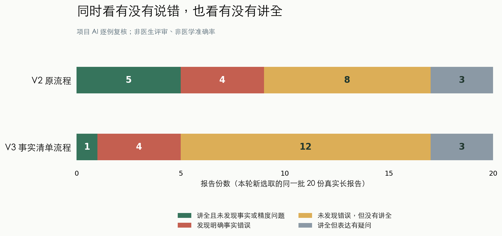

# 事实清单版：真实长报告实测

本轮保留旧版，使用学校 A100 上同一个 Qwen3.5-27B 模型，对20份本项目新选取的真实长报告重新做了配对比较，并在其中固定10份上去掉清单，检查清单本身是否有帮助。没有重新训练权重。

**结论：这次事实清单流程没有整体超过旧版，不替换原来的默认方案。** 新版确实修正了部分旧错误，也增加了词语解释，但完整可用的中文报告更少，推理更慢。

| 同一批20份报告，四类互不重叠 | 旧版 V2 | 事实清单 V3 |
|---|---|---|
| 讲全且未发现事实或精度问题 | 5 | 1 |
| 发现明确事实错误 | 4 | 4 |
| 未发现明确错误，但没有讲全 | 8 | 12 |
| 讲全，但表达精度有疑问 | 3 | 3 |

“讲全”指重要临床内容都解释出来；单纯章节编号不影响这一判断。未翻译的临床句子会明确保留英文，仍算没有讲全。“未发现问题”是项目AI审阅结论，不等于保证正确，更不是医学准确率。

<!-- pagebreak -->

## 这轮是怎么做的

原流程逐句生成中文，再核对。新版先列事实清单：有什么发现、在哪里、数值是多少、是否否定、与以前相比怎样、只是怀疑还是已经确定。每条都附原文依据；再写中文，最后同时检查有没有新增事实和遗漏事实。原文始终保留。

清单不是人工写的，也是模型生成的。格式或引用检查不通过时，程序改为直接参考原文生成，再做相同复核。最终235个已生成片段使用了可用清单，另有114个从原文生成，不能把它们都算作清单的功劳。

先用旧失败例开发，选定候选后冻结推理代码和模型，才开始新测试。最初计划40份，依据旧例耗时，在看到任何新预测之前固定缩到20份；原名单和修订记录保留。看过新结果后，没有删难例、调参数或挑最好的一次。

## 为什么没变好：三个实际例子

**清单写对，中文仍会写偏。** 第10份报告的清单保留了26%的增幅，最后中文却多加“体积”，变成体积增加26%。数字一样，含义变了；复核模型和数字检查都没有挡住。同一份里，新版恢复了旧版遗漏的邻近肠袢关系，所以局部修正和新错误同时存在。

**模型知道关键词，却没有保住语气。** 第5份报告的清单准确保留Consider，中文仍把“考虑安排超声”变成直接建议。列出重点，并不能保证写答案时不偏离重点。

**检查过严，也会把可用内容拦掉。** 第17份报告的章节编号1被当成医学数字，正确的淋巴结中文因没有重复编号而被拒绝。另一些词义解释也被误认为新增患者事实。用户最终看到英文原文，整份解释就不完整了。

检查也确实挡住过错误，例如阻止把有歧义的日期强行解释成某一天。问题是挡住之后仍没给出完整中文。第12份中旧错误是真正被修正的，只是报告别处仍未解释；不能把所有错误减少都说成拒绝输出造成。

<!-- pagebreak -->

## 去掉清单，会怎样

下面只比较预先固定的同一10份报告。两列都使用新版生成、复核和重试流程，唯一预设差异是是否先提取清单。它用于探索机制，不能与20份主测试直接混算。

| 同一10份报告，四类互不重叠 | 不提取清单 | 提取清单 |
|---|---|---|
| 讲全且未发现事实或精度问题 | 1 | 1 |
| 发现明确事实错误 | 1 | 2 |
| 未发现明确错误，但没有讲全 | 5 | 4 |
| 讲全，但表达精度有疑问 | 3 | 3 |

两种流程都只有1份完整忠实解释。提取清单时，重要临床内容讲全的报告为6份，去清单为4份（其中仍可能有错误）；清单帮助多输出了一些内容，却多出1份明确术语错误。去清单后，第19份主报告不再把钙盐沉积说成肉芽肿的成因，这是真正修正，不是隐藏该句。但同批其他报告更不完整。因此不能说简单删掉清单就能解决问题，也没有看到清单带来整篇成功率的收益；样本只有10份。

## 真实代价

| 指标 | 旧版 V2 | 事实清单 V3 |
|---|---|---|
| 主测试20份累计生成时间 | 45.0分钟 | 122.1分钟 |
| 每份报告生成时间中位数 | 119.7秒 | 351.8秒 |
| 主测试调用模型次数 | 902 | 300 |

新版主测试耗时约为旧版2.7倍，其中列清单占新版模型调用耗时约57.3%。调用次数少不代表快：每次写出的清单和核对文本更长。去清单10份耗时22.9分钟，同一10份有清单为47.9分钟。

以上是逐份生成时间，不含下载、加载、排队、开发和人工式审阅。原GPU分配在17对报告完成时主动交接；续跑重新下载55.6GB同版模型，实际花了约24分钟，并核对全部23个文件的散列。第一段续跑到学校时限时还差5份，第二段恢复只补这5份，又下载24分31秒（含一次自动断点续传）。最后作业于19:33:51 UTC完成，即布里斯班次日05:33；距本轮13:33启动约6小时，比原约5小时估计多约1小时。所有额外时间用于同一固定队列，没有新增实验。

<!-- pagebreak -->

## 下一步最值得改哪里

优先校准最后的改写与检查，让它少漏掉错误、也少拒绝正确解释；先验证一个更简单的“忠实事实短句＋独立术语卡片”流程。两种清单开关下都出现了这些问题，所以只改清单或继续加步骤，暂时缺乏足够依据。

先把“报告对这个病人说了什么”和“术语本身是什么意思”分开显示。患者事实用短句忠实解释，术语解释放在独立小卡片里，减少核对器把一般知识误认为新诊断的机会。数字除了检查数值，还要检查描述的是长度、体积、比例还是时间；“考虑”“可能”“不能排除”等语气也要单独核对。

这些是下一轮的候选改法，本轮没有看到新测试后偷偷修改并重跑。下一轮先把本轮失败作为开发材料，用包括正确释义、编号、日期、建议强度和同数值不同测量含义的例子校准检查器，再另取新的报告评估。更大的模型或更多检查步骤都需要实测，不能预先当作更好。

## 结果能说明什么，不能说明什么

20份原文长1019–3309个英文字符；“长”是相对这个数据集。它们来自BIMCV-COVID19真实放射报告的英文译文，并非中国医院原生中文病历。数据来源说明见[BioLaySumm任务论文](https://aclanthology.org/2025.bionlp-1.31/)。排除了本项目此前用过的重复和近重复文本，但不能保证患者级独立，也不知道基础模型预训练是否见过。

全部50次最终输出由项目AI对照原文逐例审阅，审阅绑定输出散列；固定10份详细检查原始清单，另外检查了出错例。共详审12份清单，其中2份发现原文摘录漏项；程序拒绝对应清单，最终走原文路径，漏项没有传到最终展示的中文。其余8份清单没有逐项详审，不能视为已验证。这不是医生盲评，也没有患者阅读测试。新版增加了括号词义说明，但仍含术语，不能声称已经证明患者更容易理解。

157项本机可运行测试在冻结前通过，后加的4项汇总检查和3项连续恢复检查分别通过；它们验证程序契约，不验证医学正确性。两个旧V1依赖Torch的测试模块在本机环境不可用，未计入。学校27B结果不代表8GB Mac上的4B模型，本轮没有替换本机默认入口。

旧版代码、权重与结果保留。三个本地HTML示例分别展示完整解释、仍有错误、没有讲全，模型文字未手工修正。完整真实原文与预测保存在本项目私有数据目录，不提交GitHub；GitHub保存代码、匿名审阅摘要、锁文件和运行散列。

[查看本轮代码、逐例问题和复现说明](https://github.com/lucaaaas-glich/radiology-plain-zh/pull/3)
